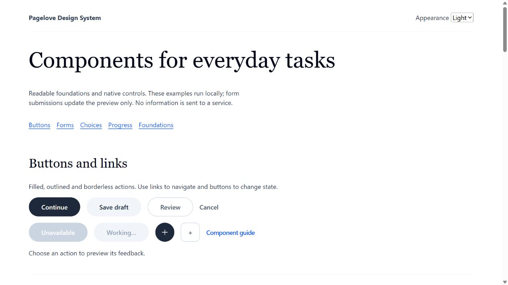

# Pagelove Design System

Design files for building understandable, accessible applications with people and AI agents. Use the formats your tools support: Markdown, plain text, JSON, DTCG tokens, YAML, XML, CSV, CSS, Sass, Less, JavaScript, TypeScript, HTML, SVG, Swift and Kotlin string dictionaries, and Stitch DESIGN.md.

## Start here

1. Read [DESIGN.md](DESIGN.md) for the visual system and [the foundations guide](docs/foundations.md) for the exact scales and modes.
2. Read [document-first development](docs/document-first.md) before choosing an app's domain model. Token JSON is interchange data, not a requirement to model app content in JSON.
3. Choose [components](docs/components.md) and [patterns](docs/patterns.md). For games, also read [game experience guidance](docs/games.md).
4. Open [the component catalog](examples/catalog.html), or serve the repository with `npm run serve` and visit `http://127.0.0.1:4173`.

Node.js 22 or later is used only for generation, verification and the optional preview server. No package installation or third-party runtime is needed. HTML/CSS examples can be opened directly from disk. Fonts use explicit local fallbacks; font files and trademarks are not bundled.



```sh
npm run build
npm run check
npm run serve
```

## Pick a format

| Need | Files | Status |
| --- | --- | --- |
| Human and LLM guidance | `DESIGN.md`, `docs/*.md`, `AGENTS.md`, `llms.txt` | Authored guidance; explicit entry points |
| Canonical foundation data | `tokens/foundations.json` | Editable source, including text styles and grids |
| Canonical semantic themes | `tokens/semantic.json` | Editable light/dark roles referencing foundation CSS names |
| Optional visual profiles | `tokens/profiles.json`, `profiles/*/DESIGN.md` | Editorial and invitation styles |
| Standard design-token exchange | `tokens/*.tokens.json` | DTCG 2025.10 structure; load foundations plus one semantic mode |
| Figma plugin exchange | `exports/tokens-studio.json` | Tokens Studio adapter; verify against your plugin version |
| Browser UI | `styles/*.css`, `components/`, `examples/` | Framework-independent HTML/CSS with optional JS |
| Structured interchange | `exports/tokens.json`, `.yaml`, `.xml`, `.csv` | Generated; units preserved |
| Source code consumption | `exports/tokens.mjs`, `.cjs`, `.ts`, `_tokens.scss`, `tokens.less` | Generated; resolved theme values |
| Native app integration | `exports/Tokens.swift`, `exports/Tokens.kt` | CSS-string dictionaries; explicit native conversion required |
| Visual reference | `assets/palette.svg`, `assets/previews/` | Palette plus rendered catalog screenshots |
| Stitch | `.stitch/DESIGN.md`, `.stitch/README.md` | YAML tokens plus Markdown rationale; no project IDs required |
| Framework examples | `examples/frameworks/` | Small React, Vue and Svelte usage adapters; see integration limits |
| Plain context | `exports/tokens.txt`, `exports/tokens.md`, `llms-full.txt` | Generated context for text-only consumers |

This repository provides portable sources and concrete adapters, not guaranteed compatibility with every app or model. Native authoring formats such as `.fig` and `.sketch` are not fabricated. Imported originals may be added when available, with their provenance and license.

## Source authority

The supplied public design library is the default app foundation. The reference design guide supplies principles and optional editorial/invitation profiles. App tokens and brand profiles differ intentionally. Components consume semantic roles; semantic roles reference foundations. Update canonical JSON, then regenerate exports. Generated formats are not separately editable authorities.

The published library's exact typography classes remain available. The recommended app layer increases target sizes, avoids tightly tracked body copy, preserves zoom and strengthens reduced motion. See [adaptations and provenance](reference/PROVENANCE.md).

## Contribute

Describe the intended behavior, change its canonical source, rebuild, and run checks. Inspect light/dark, narrow/wide, keyboard, error, loading and reduced-motion behavior for affected components. Record meaningful changes in [the audit log](audit/CHANGELOG.md). See [format limitations](docs/formats.md) and [accessibility](docs/accessibility.md).

Code, tokens and examples are MIT licensed. The document-first adaptation retains CC BY 4.0; see [NOTICE](NOTICE.md). No trademark or third-party font rights are granted.
