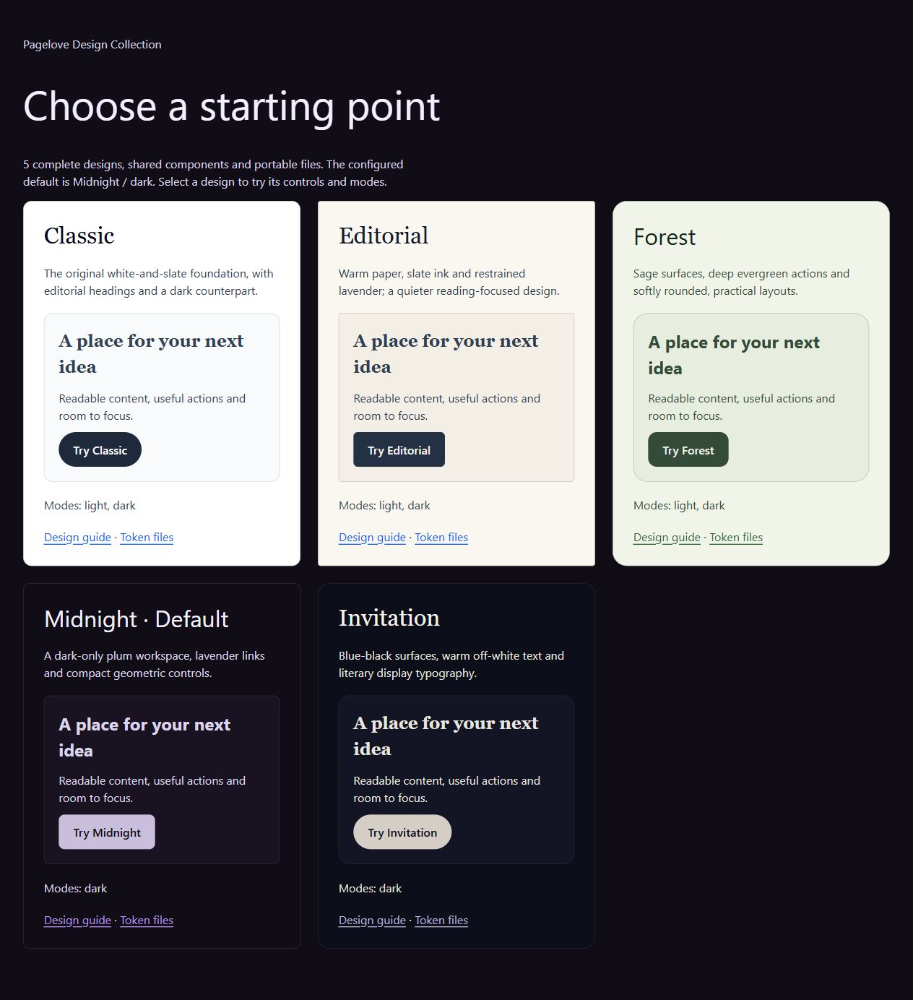
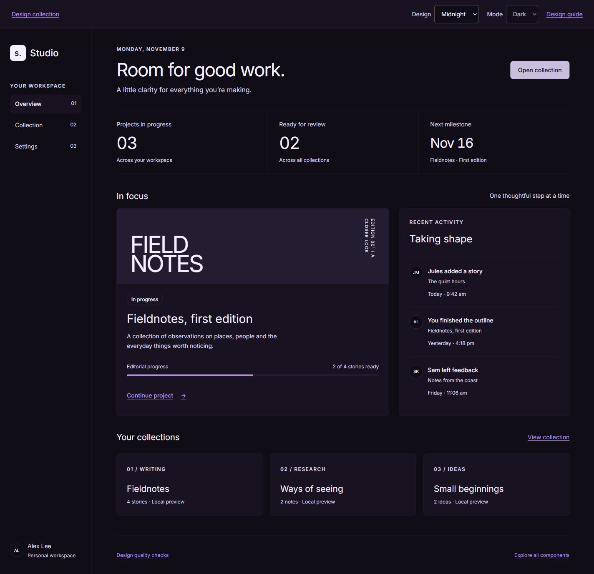

# Pagelove Design Collection

Multiple complete designs, shared accessible components, and portable files for people, design tools and AI agents.

## Choose a design

| Design | Character | Modes |
| --- | --- | --- |
| [Classic](designs/classic/DESIGN.md) | Original white/slate surfaces, serif headings, pill actions | Light and dark |
| [Editorial](designs/editorial/DESIGN.md) | Warm paper, slate ink, restrained geometry | Light and dark |
| [Forest](designs/forest/DESIGN.md) | Sage backgrounds, evergreen actions, sans-serif headings, soft corners | Light and dark |
| [Midnight](designs/midnight/DESIGN.md) | Deep plum workspace, lavender links, compact geometry | Dark |
| [Invitation](designs/invitation/DESIGN.md) | Blue-black, warm off-white, literary serif typography | Dark |

**Default: Midnight / dark.** The current setting is in [designs/catalog.json](designs/catalog.json). Root `DESIGN.md`, `.stitch/DESIGN.md`, `exports/` and token exports are generated for that default. Each design has the same formats under `designs/<id>/`.

Open [the design gallery](examples/designs.html) or [the interactive component preview](examples/catalog.html). Both work from local files. The preview selects design and mode independently, shows only supported modes, and keeps choices in its URL. Without JavaScript, the component page uses the configured default; the gallery still links to each design's files.



## Use it in an app

1. Read the selected `designs/<id>/DESIGN.md` and shared [document-first guidance](docs/document-first.md). If no design is requested, use the catalog default and its initial mode.
2. Load `styles/app.css` once. Apply the selected design and supported mode to the document:

```html
<html lang="en" data-design="forest" data-theme="light">
```

3. Use shared components and semantic roles. The design supplies colors, fonts, shapes and spacing. Do not mix arbitrary values from several designs.
4. For another tool, use that design's `exports/`, `tokens/*.tokens.json` or `.stitch/DESIGN.md`. Fonts have explicit fallbacks; local font files and their OFL licenses are bundled. Trademarks are not included.

Omitting both attributes uses the configured default. For an isolated CSS bundle, load styles/fonts.css, styles/library-components.css and styles/base.css followed by `designs/<id>/styles/theme.css`; that bundle starts in the design's own initial mode. See [selection and authoring](docs/designs.md).

## Formats

Every design produces Markdown and plain text guidance; JSON, YAML, XML and CSV tokens; DTCG files; a Tokens Studio adapter; CSS, Sass and Less; JavaScript ES/CommonJS and TypeScript; Swift/Kotlin CSS-string dictionaries; an SVG palette; and Stitch-compatible `DESIGN.md`. [Format limitations](docs/formats.md) describe conversions and untested tool imports. React, Vue and Svelte examples remain shared.

## Change or add designs

Edit `designs/catalog.json` to set `defaultDesign` and `defaultMode`. Edit `designs/<id>/design.json` for foundation overrides, mode-specific role overrides, typography/shape/spacing and visual guidance. Shared sources remain in `tokens/`. Other design files are generated; do not edit exported copies.

```sh
npm run build
npm run check
npm run serve
```

Node.js 22+ is needed for these scripts. Generation has no runtime dependencies. Run npm ci for the pinned validation tools. The preview opens at `http://127.0.0.1:4173`. Checks cover token completeness, mode availability, default regeneration, selected contrast pairs, escaping, public-content restrictions and deterministic exports. Browser results are recorded separately.

The original `tokens/profiles.json` is retained as historical reference. Its guides point to the complete selectable designs; `data-profile` is deprecated for design selection.

Code, tokens and new documentation are MIT licensed. The document-first adaptation retains CC BY 4.0; see [NOTICE](NOTICE.md). Source credits remain in [provenance](reference/PROVENANCE.md).

## Complete app examples

Explore [the workspace](examples/workspace.html) for matching overview, collection/detail and settings screens in every design. Read the [product polish contract](docs/polish.md) for typography, spacing, component states and responsive behavior. Fonts are bundled locally under their included OFL licenses.




The app examples also expose per-collection URLs, local draft creation, derived counts and 100–200% reading preferences. [Quality checks](examples/quality.html) report real font loading and effective motion settings. See the [polish review](reference/POLISH-REVIEW.md) for gaps found and revisions.

## Use one design independently

Each design includes a standalone integration example: [Classic](designs/classic/preview.html), [Editorial](designs/editorial/preview.html), [Forest](designs/forest/preview.html), [Midnight](designs/midnight/preview.html), [Invitation](designs/invitation/preview.html). These load only that design’s theme plus shared fonts/components/base styling. See [integration instructions](docs/designs.md) and the [portability review](reference/PORTABILITY-REVIEW.md).

## Verification and reusable patterns

Use [app patterns](examples/patterns.html) over the local HTTP server for tabs, disclosure, confirmation, error recovery, records and RTL examples. Read the [support matrix](docs/support.md), [release notes](docs/releases.md), [content guidance](docs/content.md) and [contribution requirements](CONTRIBUTING.md).

The patterns preview switches designs and supported modes while preserving your current draft. The [wider review](reference/WIDER-REVIEW.md) records the coverage map, independent format consumers, complete workspace tasks and remaining limits. The [core controls review](reference/CORE-CONTROLS-REVIEW.md) records follow-up fixes for original controls, typography conversions and selected-mode guide links. The [collection consistency review](reference/CONSISTENCY-REVIEW.md) records component, resolver and keyboard fixes, passing browser checks and remaining manual verification.

After npm ci, run npm run check:external for schema validation, the official Stitch linter, resolver composition, public CSS references, Tailwind compilation, independent export consumers, framework compile/server-render checks and size budgets. npm run test:browser runs task and accessibility checks in three browser engines; install them with npx playwright install first.
