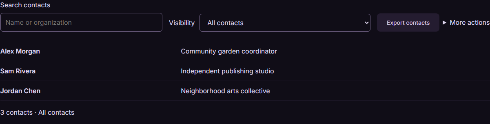
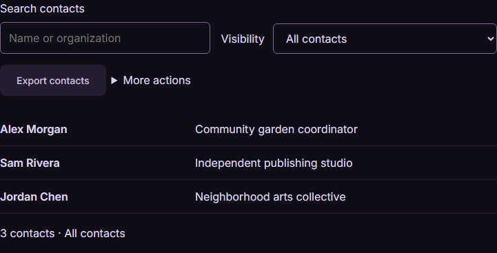
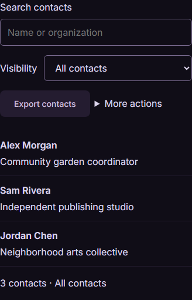

# Responsive Component Behavior and Visual Acceptance

Responsive means readable, usable and deliberately composed, not merely fitting inside the viewport. Review the contents of controls and the relationships between them after reflow. A page-overflow check alone cannot establish this contract.

## Wrapping by content type

| Content | Required behavior |
| --- | --- |
| Short actions such as Move to album, Previous week, Export contacts and Print / PDF | Keep the label intact at normal reading sizes. Give the control its intrinsic width and move the complete control to a new row before compressing its text. |
| Currency, percentages, compact dates and identifiers whose splitting changes readability | Keep the meaningful unit intact. Use a scoped atomic span, tabular numerals where useful, and enough space for realistic large/negative/localized values. |
| Field label and input/select | Treat as one group. Reflow the whole group, or deliberately place the label above the input. Keep the visible label associated with its control. |
| Metric labels, descriptions, article titles and other prose | Allow natural word wrapping. Give columns a useful minimum width; reduce the column count before breaking ordinary words into fragments. |
| Very long localized actions or text at enlarged sizes | Stack actions and allow intentional whole-word wrapping when the complete label cannot fit a full available row. Keep adjacent actions aligned in height when they share a row. Never shrink text, clip it or remove its visible label to force one line. |
| Unbroken user content such as URLs | Use a scoped emergency break where necessary. Do not apply `overflow-wrap: anywhere` or `word-break: break-all` indiscriminately to action labels, amounts or metric labels. |

Do not apply blanket `white-space: nowrap`. It can move the defect from wrapped text to clipping or horizontal scrolling. Atomic values must still fit their container: widen/stack their column or use a documented, unambiguous compact format with the complete value visibly available. Do not silently round financial values, hide essential figures behind a tooltip, or mark overflowing content as an exception.

## Groups and available space

Size a toolbar against its actual container, including a sidebar, panel padding and scrollbars. A viewport breakpoint is not proof that a nested toolbar has enough space. Prefer content-driven wrapping; use container breakpoints for deliberate composition changes. [`min-width`](https://developer.mozilla.org/en-US/docs/Web/CSS/Reference/Properties/min-width) affects intrinsic flex/grid sizing: give flexible search/input tracks `min-inline-size: 0`, while protecting action contents from unnecessary shrinking.

Keep related Previous/Next or bulk actions in one wrapper that can move as a unit. Inside that wrapper, stack complete actions when necessary. Use stretch alignment for actions on the same row, consistent target sizes and explicit gaps. Preserve DOM reading/focus order; do not use visual ordering to conceal a disconnected action. Menus and dialog footers must obey the same rules as the main screen.

## Reusable reference layouts

Load `styles/app.css`, optional `styles/patterns.css`, then [styles/responsive.css](../styles/responsive.css). The new classes are opt-in: the preserved library stylesheet and existing app layouts are not rewritten. The [interactive reference](../examples/responsive.html) contains all six compositions in every supported design/mode:

| Composition | Reusable classes and behavior |
| --- | --- |
| Search, filters and actions toolbar | `ds-toolbar`, `ds-search`, `ds-actions`: flexible search; whole field/action groups move to new rows; stack below a 28rem container. |
| Label-and-select | `ds-control-group`: wrapping group with a noncompressed label and flexible select; label moves above the select when needed. |
| Previous/Next | `ds-action-pair` with `ds-action` buttons: complete labels, shared-row height alignment, full-row actions when stacked. |
| Bulk selection | `ds-bulk-actions`: selection summary and associated action group stay together; keep feedback visible after reflow. |
| Metrics | `ds-metric-grid`, `ds-metric`, `ds-atomic`: columns have a 14rem minimum capped at available space; labels wrap at words and figures remain intact. |
| Dialog actions | `ds-dialog-actions` with `ds-action`: actions wrap or stack in DOM order; dialog body scrolls when necessary and focus remains reachable. |

Wrap the composition in `ds-responsive-surface` to establish its inline-size container. `ds-action` extends the existing `pl-button` markup; it controls layout and wrapping, not the selected palette. For example:

```html
<div class="ds-responsive-surface">
  <div class="ds-toolbar">
    <div class="ds-control-group">
      <label for="album">Move to album</label>
      <select id="album" class="ds-select">
        <option>Summer field notes</option>
      </select>
    </div>
    <div class="ds-actions" role="group" aria-label="Album actions">
      <button type="button" class="pl-button pl-button--regular pl-button--md ds-action">
        <span class="pl-button__label">Move selected</span>
      </button>
    </div>
  </div>
</div>
```

<details>
<summary>See the toolbar at wide, intermediate and narrow sizes</summary>

Midnight/dark, 100% text. The groups change rows while action labels stay intact.

1280px viewport / 1200px container:



768px viewport / 721px container:



375px viewport / 328px container:



</details>

Use the full example's native semantics and handlers when copying an interaction. These are layout references with local sample state, not persistence or backend services. The 28rem/14rem choices are reference composition values, not universal product breakpoints. Record the actual transitions used in the consuming app.

Native selects cannot wrap their closed value. For a long choice, visibly repeat the complete selection beside/below the field and associate it as a description, as the album example does. The diagnostic recognizes `data-layout-value` only when it names a visible element containing the actual selected option. Native editable values may scroll inside their input; their labels and surrounding controls still need layout checks.

## Visual acceptance gate

Review **320, 375, 768, 1024, 1280 and 1768 CSS-pixel viewport widths**, plus just below, at and just above every component layout transition (normally ±1 CSS pixel). Record container widths as well. Automatic grid/flex transitions also need inspection; do not test only declared media queries. The reference has a 28rem toolbar transition and metric column transitions at 29rem, 44rem and 59rem, with its 1rem gaps.

At those widths, exercise populated screens, long realistic content, selection/bulk actions, empty/recovery states, detail/secondary views, edit forms, validation errors, open menus, and dialogs. Check each affected design/mode and actual localized content used by the app. Include negative/large amounts, longer dates and long labels without inventing impossible sample content merely to fit the layout.

Acceptance requires:

- No clipped text, overlapping controls or unintended horizontal overflow, including inside panels, menus and dialogs.
- Intact short action labels and meaningful figures; no accidental word fragments in metric labels. Long prose and editorial headings may wrap naturally.
- Consistent heights for adjacent actions on a shared row, adequate targets, and clear relationships and spacing after reflow.
- Keyboard access, visible/unobscured focus, sensible focus order, dialog Escape/focus return and working recovery actions.
- Readable enlarged layouts: check 200% text and text-spacing overrides, and actual browser zoom/reflow separately. A 320px or root-font-size fixture is not a browser-zoom trial. The [W3C reflow](https://www.w3.org/WAI/WCAG22/Understanding/reflow.html) and [resize-text](https://www.w3.org/WAI/WCAG22/Understanding/resize-text.html) guidance describe the accessibility requirements; this repository's six-width visual gate adds composition checks.

## Automation supports screenshot review

[tests/helpers/responsive-audit.mjs](../tests/helpers/responsive-audit.mjs) provides a browser-side diagnostic for declared short labels, atomic values, word-preserving text, control clipping/compression and action-row heights. Mark the elements you intend to check; unmarked content is not automatically certified. The [regression tests](../tests/responsive.spec.mjs) include deliberately broken controls to prove that a no-overflow page can still fail. Resolve flags or document a specific intentional exception, then rerun the affected states.

Apply `data-layout-short` to a short label, `data-layout-atomic` to a complete figure/date, `data-layout-words` to text that must not split ordinary words, and `data-layout-check` to other content boxes. Mark related action wrappers with `data-layout-equal` and their actual available-width wrapper with `data-layout-container`. The shared action/input/select classes are checked automatically too. Run the helper in a rendered browser, for example `page.evaluate(auditResponsiveLayout)`, and require an empty `issues` array. Retain its container measurements and exceptions with the screenshot record.

For enlarged text or a genuinely long translation, `allowLongLabels: true` permits whole-word label wrapping only when the intrinsic label cannot fit a complete available row. An explicit `data-layout-exception="reason"` can identify an intentional editorial/game text treatment; it does not suppress atomic-value or clipping checks and still needs visual review. Native input/select exceptions are reported separately, not silently discarded.

Capture screenshots after fonts/content settle. **An agent or person must open and inspect the rendered screenshots.** Capturing them, producing a contact sheet, passing axe, or receiving a passing geometry result is not visual approval. Review both the overall composition and legible component detail; small thumbnails alone cannot establish text quality.

Exceptions must name the component, content, width/state, reason and evidence. Multiline editorial headings and deliberately composed game controls are valid candidates; neither exempts clipping, inaccessible focus or unreadable figures. Whole-word wrapping caused by a genuine translation/zoom constraint is different from a short label compressed beside an empty flexible track.

## Required consuming-agent report

Copy [reference/responsive-acceptance-template.md](../reference/responsive-acceptance-template.md) into the consuming app's evidence. Report the build, browser/OS, design/mode, viewport **and container** widths, breakpoints, content/state, input/zoom settings, screenshot path, whether it was actually inspected, findings, fixes and remaining limits. Distinguish automated passes, captured images and visual inspection. Do not claim all widths, states, models, devices or demos were reviewed from a representative subset.
